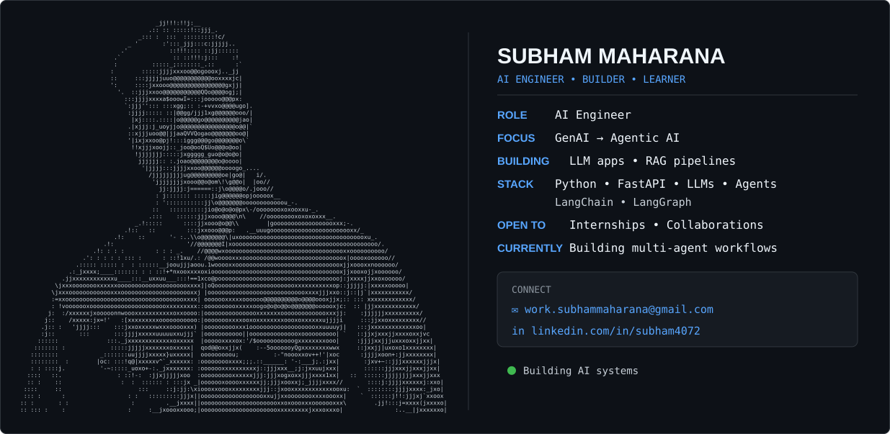

  

<picture>
  <source media="(prefers-color-scheme: dark)" srcset="dark_mode.svg" />
  <source media="(prefers-color-scheme: light)" srcset="light_mode.svg" />
  
</picture>
<h2 align="center">🧠 AI JOURNEY</h2>

<table align="center">
<tr>

<td align="center">
  
   
  <b>Machine Learning</b>
</td>

<td align="center">
  <h2>→</h2>
</td>

<td align="center">
  
   
  <b>Deep Learning</b>
</td>

<td align="center">
  <h2>→</h2>
</td>

<td align="center">
  
   
  <b>Generative AI</b>
</td>

<td align="center">
  <h2>→</h2>
</td>

<td align="center">
  
   
  <b>LLMs</b>
</td>

<td align="center">
  <h2>→</h2>
</td>

<td align="center">
  
   
  <b>Agentic AI</b>
</td>

</tr>
</table>

  <samp>
    ML → DL → GenAI → LLMs → Agentic AI
  </samp>

<h2 align="center">🧠 Technical Skills</h2>

<table align="center" cellpadding="20" cellspacing="0">
<tr>
<td align="center" width="50%">
   
  <h5>&emsp;&emsp;🐍 Programming & Data&emsp;&emsp;</h5>
  
  
    
</td>
<td align="center" width="50%">
   
  <h5>&emsp;&emsp;🤖 Machine Learning & Deep Learning&emsp;&emsp;</h5>
  
  
    
</td>
</tr>

<tr>
<td align="center">
   
  <h5>&emsp;&emsp;✨ Generative AI & RAG&emsp;&emsp;</h5>
  
  
    
</td>
<td align="center">
   
  <h5>&emsp;&emsp;🧠🤖 Agentic AI&emsp;&emsp;</h5>
  
  
    
</td>
</tr>

<tr>
<td align="center">
   
  <h5>&emsp;&emsp;⚙️ Backend & APIs&emsp;&emsp;</h5>
  
    
</td>
<td align="center">
   
  <h5>&emsp;&emsp;🌐 Frontend&emsp;&emsp;</h5>
  
    
</td>
</tr>

<tr>
<td align="center">
   
  <h5>&emsp;&emsp;🗄️ Databases&emsp;&emsp;</h5>
  
    
</td>
<td align="center">
   
  <h5>&emsp;&emsp;☁️ Deployment & Development&emsp;&emsp;</h5>
  
    
</td>
</tr>
</table>
